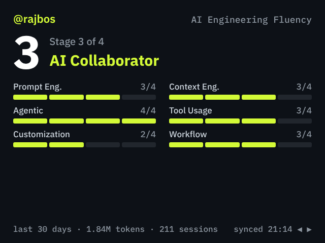

# AI Engineering Fluency

Shows your AI Engineering Fluency score, 30-day token history and QR codes for the extension and LinkedIn.



## Usage

| Control | Action |
| --- | --- |
| LEFT / RIGHT | Flip between score, 30-day history, QR to the repo and QR to LinkedIn |
| SELECT (tap) | Switch the look: Motion, 3D radar, 3D skyline |
| Tilt (3D radar look, score screen) | Left/right spins the radar, forward/back changes the viewing angle |
| Tilt forward/back (3D skyline look, history screen) | Changes the camera angle |
| Tilt (history screen) | Scrub through the days; tilt further to move faster |
| SELECT held + LEFT / RIGHT (history screen) | Step one day at a time |
| UP / DOWN (score screen) | Flip between the bars (or 3D radar) and an animated spider chart of the categories |
| UP / DOWN (history screen) | Switch between tokens and sessions |
| MENU | Open sync status |
| UP / DOWN (sync status) | Switch the look |
| SELECT (sync status, no data yet) | Show clearly labelled demo data |
| BACK | Close sync status, or exit to the launcher |

## Looks

| Look | Score screen | History screen |
| --- | --- | --- |
| Motion (default) | Bars grow in; screens slide | Bars grow in, the cursor glides with a pulsing halo |
| 3D radar | A turning radar prism with every category's name and stage | Flat bars |
| 3D skyline | Flat bars | A 3D contribution graph: a tower per day, laid out by weekday and week |

The app remembers the look in `/state/fluency_look.json`. In every look,
UP / DOWN on the score screen flips to a flat spider chart: the rings grow
out of the centre, a radar arm sweeps round once and each category pops out
to its stage as the arm passes it.

## Data

The app reads `/state/fluency.json`, written by the AI Engineering Fluency
extension. It checks the file every few seconds and redraws when it changes.
Until the extension's sync command ships, copy a file over USB:

```sh
mpremote fs cp fluency.json :/state/fluency.json
```

The format is described in
[`docs/features/BADGE-SETUP-PLAN.md`](../../docs/features/BADGE-SETUP-PLAN.md).
`assets/sample.json` is a complete example.

The file holds counts, stages and colours only: no prompts, file paths or
repository names.

## Requirements

No Wi-Fi or `secrets.py` settings are needed. If `GITHUB_USERNAME` or
`CONTACT_NAME` is set in `secrets.py` (the stock Settings app edits both),
the score screen shows your handle and the LinkedIn screen your name.

## Install

Put the badge in USB disk mode (double-tap RESET, or open the Mass Storage
app), copy this `fluency` folder into `apps/` on the `BADGER` drive, and eject.
The app appears in the launcher.
