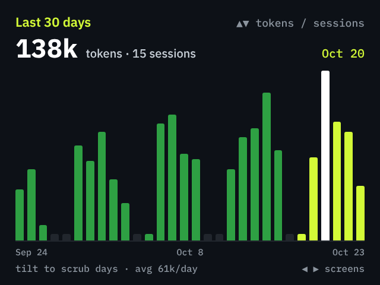
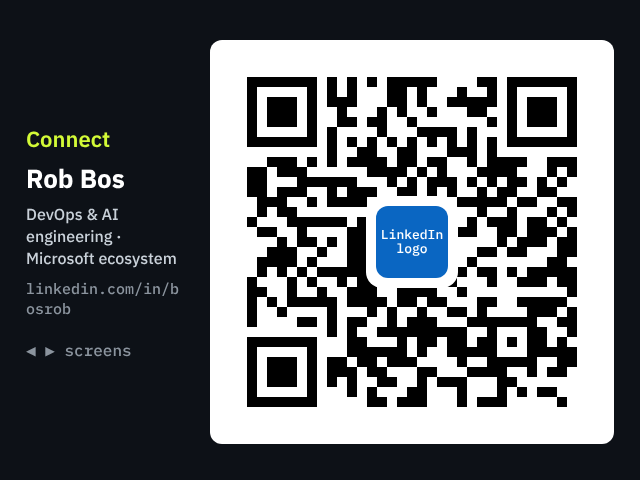
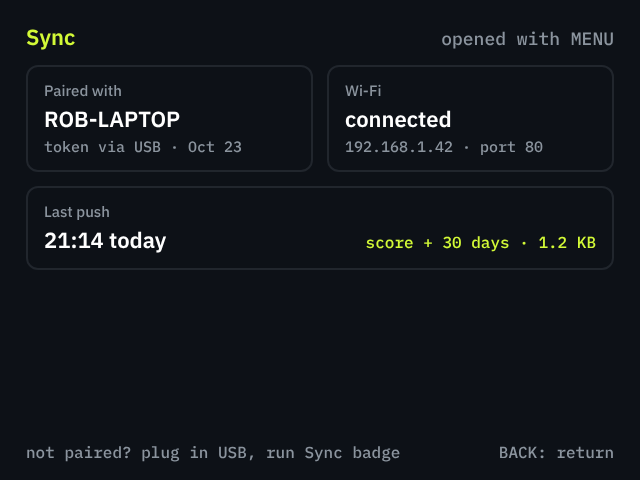
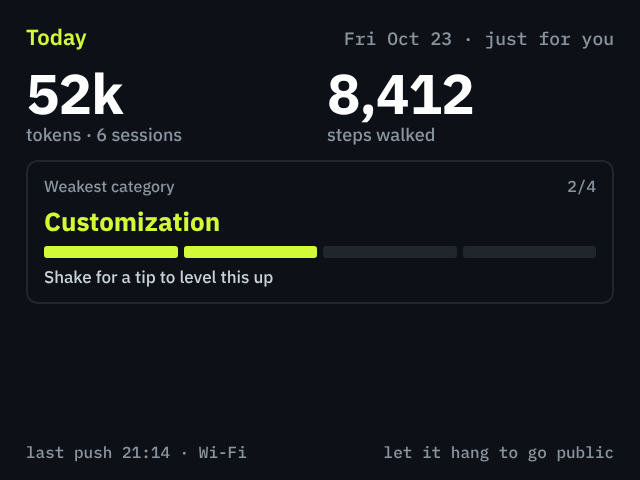
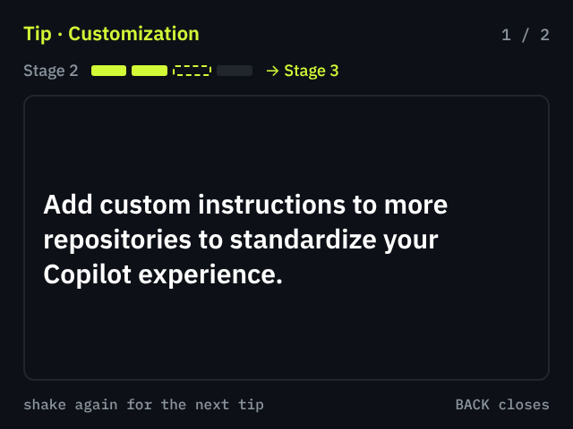
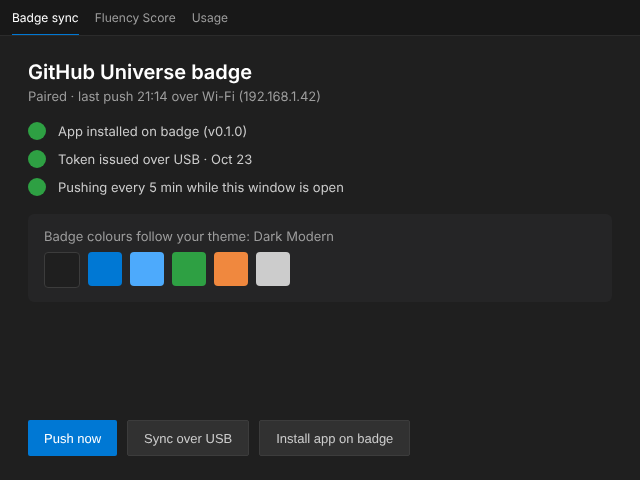

# Universe Badge — Design and Roadmap

**Status:** the badge screens ([`badge-app/`](../../badge-app/README.md)), the payload builder, USB sync, the one-click app install and the Badge setup view are built and described in [BADGE-SETUP.md](BADGE-SETUP.md). This page keeps the design decisions, the data format and the badge controls, and lists what is still to do: Wi-Fi push and the remaining motion features. Last updated 2026-10-26.

The badge app shows live data from the AI Engineering Fluency extension, plus two QR codes.

## Design decisions

**The badge shows these screens** (mockups below):

1. Fluency score: overall stage (1 to 4) and its label, plus all six categories with their names and stage values as segment bars. UP/DOWN flips to a sub-view with the same data as a spider chart, animated in like a radar scan (rings grow out of the centre, an arm sweeps round once and each category pops out to its stage as it passes), and back.
2. 30-day history: one bar per day for tokens, with a day cursor you scrub; a toggle switches to sessions.
3. QR code to `https://github.com/rajbos/ai-engineering-fluency` with the repo logo mark in the centre on a dark tile.
4. QR code to `https://linkedin.com/in/bosrob`, with a labelled placeholder until the official LinkedIn logo is added.
5. Sync status, shown on demand with MENU (and automatically when there is no data yet).

The score and history screens come in three looks the wearer switches on the badge (a tap on SELECT, or UP/DOWN on the sync screen). The choice is saved in `/state/fluency_look.json`.

| Look | What changes |
| --- | --- |
| Motion (default) | Screens slide when you flip them, the segment bars and history bars grow in, the history cursor glides with a pulsing halo, and a band sweeps across when new data lands. |
| 3D radar | The score screen becomes a turning radar prism, one spoke per category labelled with its name and stage. Left/right tilt spins it faster or backwards, forward/back tilt changes the viewing angle. |
| 3D skyline | The history screen becomes a 3D contribution graph: a tower per day, a column per weekday and a row per week. The camera sways slowly and forward/back tilt changes its angle; left/right tilt still scrubs. |

Planned, not built yet: a wearer view and a tip screen (see [Motion features](#motion-features-not-built-yet)).

**Decisions:**

- The flat score screen keeps segment bars. A radar chart was first dropped because it showed no values or category names; the 3D radar look brings it back with a name and stage on every spoke, as an option rather than the default, and the UP/DOWN spider chart sub-view does the same flat, with the stage summary beside it.
- Sync is USB for the first load, with a Wi-Fi push option planned on top. The sharing server is not used.
- Highlight colours come from the active VS Code theme, read from the webview's CSS variables, with a fixed dark ground on the badge.
- QR codes use the full URLs as they are now. Shortening them is a later experiment after testing on the device.
- The badge app lives in this repo under `badge-app/fluency/`.
- The Badge setup view is reached through an extension-point button (`registerButton`), not a full navigation icon. Promoting it is a possible follow-up.

**Dropped or deferred:** `vscode://` deep links from a QR, mDNS discovery, automatic same-network detection, and any marketplace (the badge has none; apps are copied as files).

## Mockups

Rendered at 2x the badge's 320x240 LCD, with sample data. The images live in [`badge-mockups/`](badge-mockups/).

| Score | 30-day history | QR to repo | QR to LinkedIn |
| --- | --- | --- | --- |
|  |  |  |  |

| Sync status | Wearer view (planned) | Tip after a shake (planned) | VS Code Badge setup panel |
| --- | --- | --- | --- |
|  |  |  |  |

## Setup

How to install the app and sync data is in [BADGE-SETUP.md](BADGE-SETUP.md).

**Repos and references**

| What | Where | Use |
| --- | --- | --- |
| Fluency repo | [rajbos/ai-engineering-fluency](https://github.com/rajbos/ai-engineering-fluency) | extension, CLI, `badge-app/` |
| Badge repo | [badger/home](https://github.com/badger/home) | reference apps: `badge/apps/badge` (stats), `contacts` (QR), `Copilot` (HTTP server) |
| Badgeware docs | [pimoroni/badgeware-docs](https://github.com/pimoroni/badgeware-docs) | `api/shape.md`, `api/image.md`, `guides/networking.md` |
| Design canvas | [Fluency Badge Screens](https://claude.ai/artifact/BEVQTDRFFaWYPePAHbk7qU) (private to the owner) | the badge screens and the VS Code panel, shown at 2x the 320x240 LCD |

**Tools to have**

- Node 22 and pnpm (the repo's `build.ps1` and the `pnpm run ...` scripts).
- Python 3 with `mpremote` (`pip install mpremote`) and `qrcode[pil]` for rebuilding the QR images.
- A Universe 2026 badge on USB. Only one program can own the serial port, so close other serial tools while syncing.

**Assets**

- Repo mark: `assets/AI Engineering Fluency - Transparent.png`, cropped to the robot head and bars, 28x28 on the dark tile.
- LinkedIn logo: still to collect. Save the official "in" bug PNG from LinkedIn's brand site and run `python badge-app/tools/make_qr.py --linkedin-logo <png>`.

## The badge app

A MicroPython app in `badge-app/fluency/`, copied to `apps/fluency` on the badge. Layout follows `badger/home`: `__init__.py`, a 24x24 `icon.png`, and `assets/` for the logo PNGs.

**Runtime facts** (verified in `badger/home` and `badgeware-docs`)

- Globals are provided: `badge`, `screen`, `image`, `font`, `color`, `shape`, `mat3`, `rect`, `run`, and button constants. The app ends with `run(update)`.
- Call `badge.mode(HIRES | VSYNC)` for the full 320x240 surface; the default is 160x120.
- Input is orientation-aware: `badge.pressed(BUTTON_LEFT)`, `held`, `released`. `BUTTON_MENU` and `BUTTON_BACK` drive the sync screen.
- The app folder is resolved like the `commits` app does: `/remote/apps/fluency` first, then `/system/apps/fluency`. That makes `mpremote mount` testing work without copying files.
- The badger.github.io simulator (MicroPython compiled to WebAssembly, used by the Badge Simulator canvas in `badger/home`) runs 2026 apps with the real fonts and graphics. `badge-app/tools/emulator/` runs this app in it headlessly and CI screenshots it. It has no IMU, sockets or real timing, so still test on hardware.

**Controls**

| Screen | LEFT / RIGHT | Motion | Other |
| --- | --- | --- | --- |
| Score | tap flips to previous / next screen | 3D radar look: tilt spins and angles the radar | UP / DOWN flips between the bars (or 3D radar) and the spider chart, MENU opens sync status, a tap on SELECT switches the look |
| QR repo, QR LinkedIn | tap flips to previous / next screen | none | MENU opens sync status, a tap on SELECT switches the look |
| 30-day history | tap flips screen | tilt scrubs the day cursor; 3D skyline look: forward/back tilt angles the camera | UP / DOWN toggles tokens and sessions, a tap on SELECT switches the look |
| Sync status | tap flips screen | none | UP / DOWN switches the look, BACK returns |

**Data file** `/state/fluency.json`, written by the extension (sample values; the builder is `src/badgePayload.ts`):

```json
{
  "v": 1,
  "updated": "2026-10-23T19:14:00Z",
  "stage": 3,
  "label": "AI Collaborator",
  "categories": [["Prompt", 3], ["Context", 3], ["Agentic", 4], ["Tools", 3], ["Custom", 2], ["Workflow", 3]],
  "days": [["2026-09-24", 41000, 5], ["2026-09-25", 58000, 7]],
  "tokens30": 1840000,
  "sessions30": 211,
  "today": [52000, 6],
  "theme": {"accent": "#0078d4", "link": "#4daafc", "good": "#2ea043", "warn": "#f0883e"}
}
```

Keep it under about 4 KB (the badge's data partition is roughly 980 KiB in total). Category labels are shortened to one word so they fit; the extension's full names are Prompt Engineering, Context Engineering, Agentic, Tool Usage, Customization and Workflow Integration. Days are `[date, tokens, sessions]`, the last 30 days. There is no per-day fluency score in the extension, so the graph is tokens and sessions only. Per-category `tips` are not in the payload yet (see below).

**QR codes**

- The app ships pre-rendered PNGs (`assets/qr_repo.png`, `assets/qr_linkedin.png`) and blits them 1:1. They are built by [`badge-app/tools/make_qr.py`](../../badge-app/tools/make_qr.py) at the high error-correction level with a 4-module quiet zone, and were checked to decode with OpenCV, also after blurring and lowering the contrast.
- Why not `image.qr()` on the device: `contacts` uses `image.qr(url, image.QR_LOW, 2)`, and only `QR_LOW` appears in `badger/home`. A centre logo needs the high level, which may not exist on the firmware. Pre-rendering avoids that question.
- Sizes: repo URL 41x41 modules at 4 px (196 px with quiet zone), LinkedIn 33x33 at 5 px (205 px). Both fit the 240 px screen height beside text.
- The repo mark sits on a dark rounded tile with a one-module white ring.
- The QR codes are fixed to these two URLs. A per-user URL from `CONTACT_LINKEDIN` in `/secrets.py` would need on-device generation and is left for later.

## Not built yet

### Wi-Fi push

Copy the pattern from `badge/apps/Copilot/copilot_monitor.py` in `badger/home`.

**On the badge**

- Non-blocking HTTP server on the badge's Wi-Fi address, stepped once per frame from `update()`. Bounded header parsing, one request per connection, 5 s timeout.
- Raise the Copilot app's 512-byte body cap to about 4 KB, since the payload is a few KB.
- Endpoints: `POST /fluency` (body is the JSON above, written atomically to `/state/fluency.json` via a temp file and rename) and `GET /status`. Both require `Authorization: Bearer <token>` read from `/state/fluency_pairing.json`.
- Join Wi-Fi with the stock `wifi` module and `/secrets.py` (`WIFI_SSID`, `WIFI_PASSWORD`). Connect only while the app is open, since Wi-Fi uses a fair bit of battery.
- The protocol is unencrypted HTTP with a bearer token. Fine for a trusted LAN, not for the Internet. Say so in the README.

**In the extension**

- No pairing code. The extension writes a random token to the badge over USB (`crypto.randomBytes(16)`, kept in VS Code `SecretStorage`, temp file with owner-only permissions deleted right after the copy) and every later push sends it as a bearer token.
- `POST http://<badge address>/fluency` with the global `fetch`, a 3 second timeout, JSON body.
- The address is a text field in the view, prefilled with the last good one. The badge's sync screen shows its IP, so nothing needs discovery yet.
- Settings: `aiEngineeringFluency.badge.address` and `aiEngineeringFluency.badge.autoPush`. Push on the existing 5-minute tick, and only when the payload hash changed.
- On failure show "badge not reachable, plug in USB" and keep the last success time. No retry loop.

### Motion features

All of them run on the badge. The simulators do not model the accelerometer, so they need hardware to test. Tilt to scrub history is already built.

1. **Wearer view vs audience view.** Hanging on the lanyard, the badge shows the audience screens: score, history and the QR codes. Lifted to read, it switches to a wearer screen with today's tokens and sessions, the weakest category and its stage, and the last push time. Use `badge.upside_down()` and `badge.direction()` for the orientation, with about 1 s of debounce so a swing does not flip it.
2. **Shake for a tip.** A shake (acceleration above about 2 g for a few frames, then a 1.5 s cooldown) shows one improvement tip for the lowest-scoring category. Shake again for the next tip. The tips come from the per-category `tips` in `calculateMaturityScores` (the same as `fluency --tips`), cut to at most 90 characters and 2 per category, with markdown and video links stripped to plain text. This also needs a `tips` field in the payload: `"tips": {"Custom": ["<tip text>"], "Context": ["<tip text>"]}`.

**Steps walked (stretch goal).** The LSM6DS3TR-C has a hardware step counter, but nothing in `badger/home` shows the Universe firmware exposing it.

- Check on the device first: run `dir(badge)` in the REPL and look for a step or pedometer call, and check whether the IMU is reachable over I2C from MicroPython (`hardware/README.md` in `badger/home` lists the onboard peripheral connections).
- If it is reachable, the badge counts steps itself, keeps a per-day count in `/state/fluency_steps.json`, and the wearer screen shows a line like "8,412 steps · 52k tokens today". The extension is not involved.
- If it is not, software step detection from the raw readings is the fallback. It only counts while the app is open and costs battery, so label it as approximate or drop the feature.

### Other follow-ups

- Promote the Badge button to a full navigation icon (the same as Fluency Score, Usage and the rest). It touches about 20 files, including a click handler in each screen, and `extension.ts` is size-pinned, so do it as its own PR.
- A `badge` CLI command that prints the same payload.

## Open items and risks

**Open items**

- [ ] The URL to show for the GitHub Universe badge reference. No official badge page was found yet; until one is picked, the Badge setup view links to `badger/home`, the Tufty 2350 page and badgewa.re.
- [ ] The official LinkedIn "in" logo PNG (see Assets).

**Risks to verify on the hardware**

- Whether the chosen fonts, stroke widths and the 4 px QR modules stay legible at 320x240 on the real LCD and scan from arm's length. Shortening the URLs is the lever if not.
- Whether `mpremote` writes to `/state` cleanly while the app is running, and how long the soft reset takes.
- Whether the firmware exposes the IMU's step counter, which decides if steps walked ships. Also whether tilt-scrubbing stays steady while walking.
- Wi-Fi behaviour on venue networks with client isolation: the push will fail there by design, and USB is the fallback.
- The one-click install and the `/Volumes/BADGER`, `/media` and Windows drive-label detection are not yet tried with a physical badge.
